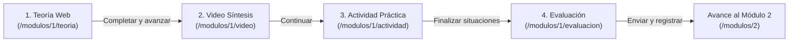

# Especificación de Módulo: Módulo 1 – Introducción a la Seguridad Digital

## 1. Metadatos del Módulo

* **ID del Módulo:** `1`
* **Título Oficial:** Introducción a la Seguridad Digital
* **Objetivo Pedagógico:** Brindar los conceptos fundamentales de seguridad de la información, el valor de los datos públicos y las reglas básicas de comportamiento digital seguro en el entorno laboral de la administración provincial.
* **Puntaje Total Asignado:** 100 puntos (25 puntos por cada uno de los 4 recursos).
* **Ruta Base Frontend:** `/modulos/1`
* **Claves de Recursos (`resource_key`):**
  * `teoria`: Lectura del material web estructurado.
  * `video`: Visualización del video de síntesis.
  * `actividad`: Resolución de 3 situaciones prácticas interactivas con feedback.
  * `evaluacion`: Aprobación/resolución del cuestionario de 6 preguntas.

---

## 2. Recorrido Secuencial y Flujo de Navegación

---

## 3. Contenido de los Recursos

### 3.1 Material Teórico (`teoria`)
* **Formato:** 3 bloques temáticos estructurados con infografías:
  1. *Qué es la seguridad digital y por qué importa en el Estado provincial.*
  2. *Los tres pilares esenciales: Confidencialidad, Integridad y Disponibilidad (Tríada CIA).*
  3. *Regla operativa básica: Reconocer → Detenerse → Verificar → Reportar.*
* **Infografías:** Ubicadas en `public/assets/module1/` (`infografia1.svg`, `infografia2.svg`, `infografia3.svg`).

### 3.2 Recurso Audiovisual (`video`)
* **Archivos:**
  * `public/assets/module1/videomodulo1.mp4`: *Parte 1 — Ciberseguridad en el Trabajo* (Síntesis conceptual, duración ~5:12 min).
  * `public/assets/module1/videomodulo1despues.mp4`: *Parte 2 — Regla de los Cuatro Pasos: Antes de actuar* (Pauta práctica preventiva, duración ~1:27 min).
* **Duración total:** ~6:39 minutos distribuidos en dos bloques didácticos independientes.
* **Contenido:**
  1. Síntesis animada de la tríada CIA, protección de activos digitales y hábitos seguros.
  2. Aplicación paso a paso de los 4 controles preventivos antes de actuar frente a comunicaciones sospechosas.

### 3.3 Actividad Práctica Interactiva (`actividad`)
Consta de **3 situaciones simuladas** basadas en incidentes reales de oficinas públicas:

| # | Título de la Situación | Contexto | Pregunta | Opción Correcta | Retroalimentación Inmediata |
| :--- | :--- | :--- | :--- | :--- | :--- |
| **1** | *Un archivo inesperado* | Correo con logo conocido, asunto "URGENTE" y adjunto imprevisto. | ¿Qué harías primero? | **Opción C:** Detenerme, revisar remitente y contexto antes de abrir o hacer clic. | *"La apariencia, el logo o la urgencia no alcanzan para confiar. Ante un archivo inesperado, conviene detenerse y verificar remitente, contexto y origen antes de actuar."* |
| **2** | *Te piden tu contraseña* | Compañero de oficina solicita contraseña por chat "por unos minutos". | ¿Cuál es la conducta adecuada? | **Opción B:** No compartir la contraseña y buscar una alternativa autorizada para resolver la tarea. | *"Las credenciales son personales e intransferibles. Conocer a la persona no elimina el riesgo: la tarea debe resolverse mediante mecanismos autorizados sin compartir la contraseña."* |
| **3** | *Un USB de origen desconocido* | Pendrive hallado en la oficina que se necesita para mover archivos. | ¿Qué opción es más segura? | **Opción C:** No conectarlo y utilizar un medio autorizado y conocido. | *"Un dispositivo desconocido puede representar un riesgo. La recomendación del módulo es no conectarlo al equipo de trabajo y utilizar medios autorizados."* |

---

### 3.4 Banco de Preguntas de Evaluación (`evaluacion`)

1. **¿Qué protege la seguridad digital en el ámbito laboral?**
   * A) Solamente las computadoras del organismo.
   * **B) Información, credenciales, sistemas, servicios y dispositivos utilizados para trabajar.** *(Correcta)*
   * C) Únicamente los archivos considerados confidenciales.
   * D) Solo los sistemas administrados por el área de informática.
   * *Justificación:* La seguridad digital abarca información, accesos, servicios y dispositivos; no solamente la computadora.

2. **¿Qué significa confidencialidad?**
   * A) Que los sistemas estén disponibles todo el tiempo.
   * B) Que la información permanezca correcta.
   * **C) Que la información sea conocida o utilizada solo por personas autorizadas.** *(Correcta)*
   * D) Que todos los archivos estén cifrados.
   * *Justificación:* La confidencialidad busca que la información sea accesible únicamente para quienes están autorizados.

3. **Recibís un archivo inesperado con el logo de una institución conocida. ¿Qué conviene hacer?**
   * A) Abrirlo porque el logo confirma su origen.
   * **B) Detenerse y verificar remitente, contexto y origen antes de abrirlo.** *(Correcta)*
   * C) Descargarlo y enviarlo a otra persona.
   * D) Abrirlo si el mensaje dice que es urgente.
   * *Justificación:* La apariencia o la urgencia no confirman legitimidad. Primero se debe verificar.

4. **¿Cuál es una buena práctica con las contraseñas?**
   * A) Usar la misma contraseña para trabajo y servicios personales.
   * B) Compartirla con compañeros de confianza.
   * **C) Mantenerla personal, no compartirla y evitar reutilizarla entre servicios.** *(Correcta)*
   * D) Anotarla cerca del monitor para no olvidarla.
   * *Justificación:* Las credenciales deben ser personales, confidenciales y no reutilizarse innecesariamente.

5. **Al ingresar a un sitio web laboral, ¿qué conviene revisar además de su apariencia?**
   * **A) El dominio y el contexto del sitio.** *(Correcta)*
   * B) Que tenga colores institucionales.
   * C) Que el logo tenga buena calidad.
   * D) Que el texto no tenga errores ortográficos.
   * *Justificación:* Una página puede imitar la apariencia de otra. El dominio y el contexto son controles más útiles.

6. **¿Cuál es la secuencia propuesta ante una situación digital dudosa?**
   * A) Abrir → analizar → consultar → borrar.
   * **B) Reconocer → detenerse → verificar → reportar.** *(Correcta)*
   * C) Bloquear → cerrar → reiniciar → reportar.
   * D) Consultar → descargar → verificar → continuar.
   * *Justificación:* El módulo utiliza la regla reconocer, detenerse, verificar y reportar.

---

## 4. Criterios de Aceptación (Definition of Done)

* [x] El agente puede navegar secuencialmente desde la teoría hasta la evaluación sin bloqueos.
* [x] Al finalizar cada etapa, se emite un `PUT /api/progress/1/{recurso}` que persiste en PostgreSQL.
* [x] Al terminar la evaluación, las respuestas se guardan con `POST /api/evaluations/1` con payload `JSONB`.
* [x] En la pantalla `/progreso`, el Módulo 1 refleja `100%`, suma `100 puntos` y desbloquea el logro *"Buen comienzo"*.
* [x] Al finalizar, el botón de cierre redirige fluidamente a `/modulos/2`.
