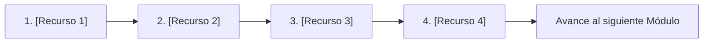

# [Plantilla Spec] Módulo X: [Título del Módulo]

## 1. Metadatos del Módulo

* **ID del Módulo:** `[2 | 3 | 4]`
* **Título Oficial:** `[Nombre del Módulo según Plan de Proyecto]`
* **Objetivo Pedagógico:** `[Breve resumen del aprendizaje esperado]`
* **Puntaje Total Asignado:** 100 puntos (distribuidos entre los recursos definidos).
* **Ruta Base Frontend:** `/modulos/[X]`
* **Claves de Recursos (`resource_key`):**
  * `[clave_1]`: [Descripción del recurso, ej. teoria_2a]
  * `[clave_2]`: [Descripción del recurso, ej. video]
  * `[clave_3]`: [Descripción del recurso, ej. actividad]
  * `[clave_4]`: [Descripción del recurso, ej. evaluacion]

---

## 2. Flujo de Navegación

---

## 3. Contenido de los Recursos

### 3.1 Material Teórico
* **Extensión máxima:** Menor a 10 carillas en total, particionado en bloques web breves.
* **Secciones:**
  1. *[Tema 1]*
  2. *[Tema 2]*
  3. *[Tema 3]*
* **Recursos Gráficos/Infografías:** `public/assets/moduleX/`

### 3.2 Recurso Audiovisual (Video)
* **Duración objetivo:** Menos de 5 minutos.
* **Guion de síntesis:** `[Resumen de la locución/puntos clave a ilustrar]`

### 3.3 Actividad Práctica Interactiva (Simulación)
Mínimo 3 situaciones laborales simuladas:

| # | Título | Contexto / Escenario | Pregunta | Opciones (Marcar la Correcta) | Feedback Didáctico Inmediato |
| :--- | :--- | :--- | :--- | :--- | :--- |
| **1** | [Caso 1] | [Situación en oficina pública] | [¿Qué harías?] | A) ... **B) [Correcta]** C) ... | [Explicación pedagógica de por qué es la conducta segura] |
| **2** | [Caso 2] | [Situación] | [¿Qué harías?] | A) ... **B) [Correcta]** | [Explicación] |
| **3** | [Caso 3] | [Situación] | [¿Qué harías?] | A) ... **B) [Correcta]** | [Explicación] |

---

### 3.4 Banco de Preguntas de Evaluación
Mínimo 5 a 6 preguntas de opción múltiple:

1. **[Enunciado de la Pregunta 1]**
   * A) [Opción]
   * **B) [Opción Correcta]**
   * C) [Opción]
   * D) [Opción]
   * *Justificación pedagógica:* [Explicación del criterio correcto]

---

## 4. Criterios de Aceptación (Definition of Done)

* [ ] El material teórico respeta la pauta de concisión (<10 páginas de Word adaptadas a bloques web).
* [ ] El video no supera los 5 minutos de duración.
* [ ] Las actividades prácticas proporcionan retroalimentación didáctica inmediata tras cada elección.
* [ ] Las claves de recursos (`resource_key`) coinciden con las registradas en `moduleData.js` y el backend en Go.
* [ ] Al aprobar la evaluación se guardan las respuestas en `evaluation_results` (`JSONB`).
* [ ] La sección "Mi Progreso" suma los 100 puntos correspondientes y avanza la barra global.
* [ ] Se verifica el acceso en un máximo de 3 clics desde el Dashboard principal.
