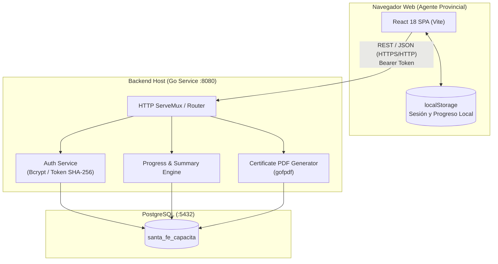

# 01 - Arquitectura General del Sistema

## 1. Visión General y Estilo Arquitectónico

La plataforma **Santa Fe Capacita** adopta una **arquitectura cliente-servidor desacoplada** con tres capas bien diferenciadas:
1. **Frontend (Capa de Presentación):** Single Page Application (SPA) construida en React 18 con Vite.
2. **Backend (Capa de Negocio y Servicios):** API REST escrita en Go utilizando exclusivamente la librería estándar `net/http` para enrutamiento de alto rendimiento, más librerías especializadas (`gofpdf`, `bcrypt`).
3. **Base de Datos (Capa de Persistencia):** Base de datos relacional PostgreSQL con soporte para transacciones ACID y tipos estructurados `JSONB`.

---

## 2. Decisiones Tecnológicas y Justificación

| Componente | Tecnología | Justificación y Criterios |
| :--- | :--- | :--- |
| **Frontend** | React 18 + Vite | Rapidez de compilación (HMR subsegundo), modularidad basada en componentes, ecosistema estándar y renderizado rápido de interfaces reactivas para usuarios no técnicos. |
| **Enrutamiento** | React Router DOM v6 | Manejo fluido de navegación cliente (SPA), protección declarativa de rutas privadas mediante componentes de orden superior (`SessionGuard`). |
| **Backend** | Go (Golang) 1.22+ | Alto rendimiento y concurrencia liviana nativa (Goroutines), binario único compilado sin dependencias externas pesadas, bajo consumo de memoria RAM (ideal para entornos con recursos acotados como servidores provinciales o microservidores). |
| **Base de Datos**| PostgreSQL 15+ | Cumplimiento estricto de integridad referencial, índices compuestos para búsquedas eficientes de progreso, y soporte para campos `JSONB` que permiten almacenar respuestas de evaluaciones con esquema flexible sin romper la normalización. |
| **Generación PDF**| `github.com/jung-kurt/gofpdf` | Generación directa en el backend en memoria (`bytes.Buffer`), garantizando que la emisión del certificado sea inmutable y no dependa de librerías cliente en el navegador que puedan ser manipuladas. |

---

## 3. Resiliencia y Manejo de Conectividad

Durante la implementación del Avance 3 se identificó que caídas temporales de PostgreSQL o del servicio de red provocaban que el frontend interpretara erróneamente los fallos de infraestructura como credenciales inválidas.

Para resolverlo, la arquitectura incorpora un principio de **tolerancia a fallos**:
* El frontend diferencia excepciones de red/servicio (`status: 0` o `status: 503`) de credenciales inválidas (`status: 401`).
* Ante una caída del backend, **la sesión local y el progreso en `localStorage` NO se eliminan**. Se presenta al usuario una pantalla amigable de reintento para que no pierda su estado al restablecerse el servicio.

---

## 4. Resolución de Red, Proxy Unificado y Despliegue

Para garantizar que la plataforma funcione de forma transparente tanto en desarrollo local (`localhost`), como en redes locales (LAN / VPN Tailscale) y en despliegues en la nube, se especifica la siguiente topología de conexión:

1. **Ruta Relativa por Defecto (`/api`):**
   * Si no se define explícitamente `VITE_API_URL`, el frontend realiza todas las peticiones contra la ruta relativa `/api`.
2. **Reverse Proxy Integrado en Vite (`vite.config.js`):**
   * Tanto en modo desarrollo (`vite`) como en previsualización de producción (`vite preview`), Vite actúa como *reverse proxy* redirigiendo `/api/*` hacia el backend Go (`http://127.0.0.1:8080` o `BACKEND_PROXY_TARGET`).
   * Esto elimina problemas de CORS y permite acceder a la aplicación desde cualquier dispositivo de la red (PC externa, celular, tablet) apuntando únicamente a la IP y puerto del servidor web.
3. **Despliegue Desacoplado o Unificado en Producción:**
   * **Unificado (Nginx / Cloud Run / Proxy):** El proxy web enruta `/api` al binario de Go y `/` a los archivos estáticos (`dist/`).
   * **Desacoplado (ej. Vercel + Render):** Se configura `VITE_API_URL=https://api.dominio.gob.ar/api` y `FRONTEND_URL=https://capacita.dominio.gob.ar` en el backend Go para restringir CORS exclusivamente al origen autorizado.
