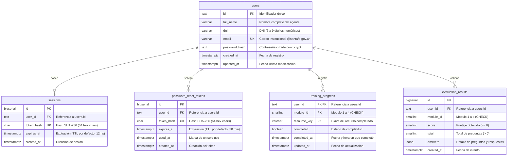

# 02 - Modelo de Datos y Esquema de Base de Datos

## 1. Diagrama Entidad-Relación (DER)

El esquema implementado en PostgreSQL garantiza integridad referencial estricta y aislamiento por usuario mediante borrado en cascada (`ON DELETE CASCADE`).

---

## 2. Definición Detallada de Tablas

### `users`
Almacena el padrón de agentes públicos registrados en la plataforma.
* **Regla de negocio:** El correo debe pertenecer obligatoriamente al dominio `@santafe.gov.ar`.
* **Seguridad:** El campo `password_hash` nunca almacena texto plano; utiliza bcrypt con costo estándar.

### `sessions`
Gestiona las sesiones activas en el backend.
* **Seguridad criptográfica:** El navegador recibe un token aleatorio en texto plano; el backend almacena únicamente su hash `SHA-256` en `token_hash`. Esto evita que un acceso no autorizado a la base de datos comprometa las sesiones activas.
* **Índices de optimización:**
  * `idx_sessions_user_id`: Búsqueda de sesiones asociadas al usuario.
  * `idx_sessions_expires_at`: Purga periódica de tokens expirados.

### `password_reset_tokens`
Administra el flujo de recuperación de contraseña ("Olvidé mi contraseña").
* **Tokens de un solo uso:** Posee un campo `used_at`. Al utilizarse el token para restablecer la contraseña, se marca la fecha/hora y queda inmediatamente invalidado. Además, se purgan todas las sesiones activas del usuario en la tabla `sessions`.
* **Expiración:** TTL estricto de 30 minutos.

### `training_progress`
Registra el avance granular de cada recurso dentro de los cuatro módulos formativos.
* **Clave Primaria Compuesta:** `(user_id, module_id, resource_key)`.
* **Diseño extensible:** Permite añadir recursos (subtemas de teoría, videos, actividades prácticas, simulaciones) sin modificar la estructura DDL de la base de datos.
* **Restricción de dominio:** `CHECK (module_id BETWEEN 1 AND 4)`.

### `evaluation_results`
Registra el histórico de intentos y calificaciones de las evaluaciones modulares.
* **Uso de `JSONB`:** El campo `answers` almacena el array completo de respuestas dadas por el agente, facilitando auditorías pedagógicas y revisiones sin necesidad de crear una tabla relacional pesada para cada opción de pregunta.
* **Índice compuesto:**
  * `idx_evaluation_results_user_module (user_id, module_id, created_at DESC)`: Permite recuperar instantáneamente el resultado más reciente del usuario para cada módulo.
