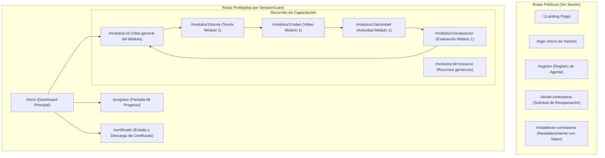

# 04 - Arquitectura Frontend, Rutas y Usabilidad

## 1. Árbol de Rutas y Navegación

La aplicación utiliza **React Router DOM v6** y organiza sus rutas en dos ámbitos claramente delimitados:



---

## 2. Componentes Clave de Infraestructura

### `SessionGuard.jsx`
Componente envoltorio de seguridad que protege todas las rutas privadas:
1. Comprueba la presencia de un token en `localStorage` mediante `getToken()`.
2. Si no hay token, redirige inmediatamente a `/login`.
3. Si hay token, consulta periódicamente `/api/auth/me` para verificar su validez.
4. **Manejo de resiliencia ante cortes:** Si la consulta a `/api/auth/me` falla por error de red o indisponibilidad del backend (`status: 0` o `status: 503`), **no cierra la sesión**: muestra un mensaje de reintento (`"Servicio no disponible"`) preservando el estado de navegación del usuario.

### `Brand.jsx` y `PublicHeader.jsx`
Proveen la identidad institucional de la **Provincia de Santa Fe** (colores azul institucional `#00346e`, blanco, gris neutro y tipografía sans-serif de alta legibilidad).

### `ModuleResourceHeader.jsx`
Barra de navegación contextual para recursos de capacitación:
* Muestra el módulo actual, el nombre del recurso y el botón de retorno seguro al Dashboard o índice del módulo sin perder el progreso.

---

## 3. Cumplimiento de Usabilidad: La Regla de los 3 Clics

El Requerimiento No Funcional aprobado en el Avance 1 exige que cualquier contenido o actividad sea accesible en **un máximo de tres clics** desde el menú principal:

| Destino | Recorrido de Clics | Total Clics | Cumple RNF |
| :--- | :--- | :--- | :--- |
| **Teoría de Módulo 1** | Dashboard (1 clic en "Continuar módulo") → Teoría | **1 clic** | ✅ Sí |
| **Video de Módulo 1** | Dashboard (1 clic en módulo) → Lista de recursos (1 clic en "Video") | **2 clics** | ✅ Sí |
| **Actividad Práctica** | Dashboard (1 clic) → Lista de recursos (1 clic) → Iniciar actividad | **2 clics** | ✅ Sí |
| **Evaluación Modular** | Dashboard (1 clic) → Módulo (1 clic) → Iniciar evaluación | **2 clics** | ✅ Sí |
| **Mi Progreso** | Barra superior / Menú (1 clic en "Mi progreso") | **1 clic** | ✅ Sí |
| **Descarga Certificado**| Menú (1 clic en "Certificado") → Botón "Descargar PDF" | **2 clics** | ✅ Sí |

---

## 4. Gestión de Estado y Almacenamiento Local

El cliente mantiene tres claves principales en `localStorage`:
* `sf-capacita-token`: El token de sesión emitido por el backend.
* `sf-capacita-current-user`: Objeto JSON con `{id, fullName, dni, email}` del agente activo.
* `sf-capacita-progress`: Estructura JSON con el avance de recursos de cada módulo `{1: {...}, 2: {...}, 3: {...}, 4: {...}}`.

Cada vez que el progreso cambia (localmente o por sincronización con `/api/progress`), se despacha un evento nativo en la ventana:
```javascript
window.dispatchEvent(new Event('sf-progress-updated'));
```
Esto asegura que la barra de navegación, las tarjetas de módulos y la pantalla "Mi Progreso" se actualicen inmediatamente sin requerir una recarga completa de la página.
