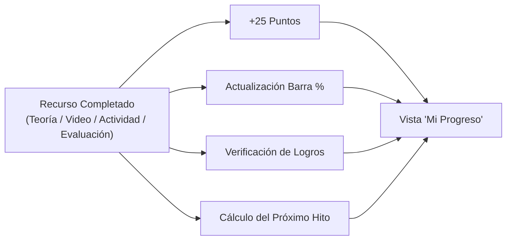

# 05 - Motor de Gamificación y Certificación

## 1. Los 4 Elementos de Gamificación Exigidos

En respuesta a la devolución de la cátedra en el Avance 2 (que exigió explicitar y desarrollar al menos 4 elementos de gamificación concretos), la plataforma implementa:

1. **Sistema de Puntos Acumulativos:** Recompensa el esfuerzo continuo del agente.
2. **Indicadores Visuales de Progreso:** Barras porcentuales globales y modulares con anillos de completitud.
3. **Catálogo de Logros (Insignias):** Hitos pedagógicos desbloqueables según el avance.
4. **Próximo Objetivo Sugerido (Hito Inmediato):** Call-to-action dinámico que orienta al agente hacia su siguiente paso sin fricción cognitiva.

---

## 2. Reglas de Puntuación y Ponderación

### Puntos y Ponderación por Módulo
* **Total de la capacitación:** 400 puntos máximos.
* **Por módulo:** 100 puntos (cada uno de los 4 módulos equivale al 25% del total).
* **Distribución de las 4 etapas estándar:**
  * **Teoría:** 25% (25 puntos).
  * **Video:** 25% (25 puntos).
  * **Actividad práctica:** 25% (25 puntos).
  * **Evaluación modular:** 25% (25 puntos).
* **Particularidad del Módulo 2:** El 25% teórico se divide en partes iguales entre los seis subtemas (2.a a 2.f).

---

## 3. Catálogo de Logros (Insignias)

| Código | Título de la Insignia | Condición de Desbloqueo | Mensaje Pedagógico |
| :--- | :--- | :--- | :--- |
| `badge_first_step` | **Primer paso** | Completar el primer recurso de cualquier módulo | *"Diste inicio a tu capacitación en ciberseguridad."* |
| `badge_module_1` | **Buen comienzo** | Finalizar el Módulo 1 al 100% | *"Completaste la introducción y comprendés los fundamentos de seguridad digital."* |
| `badge_halfway` | **En progreso** | Alcanzar 200 puntos (50% de la capacitación) | *"Completaste la mitad del recorrido formativo provincial."* |
| `badge_active_sec` | **Ciberseguridad activa** | Aprobar todas las actividades prácticas | *"Demostraste destreza práctica ante situaciones simuladas de amenazas."* |
| `badge_certified` | **Agente Certificado** | Completar los 4 módulos (100% de la capacitación) | *"Finalizaste con éxito toda la capacitación oficial de Santa Fe."* |

---

## 4. Motor de Certificación y Generación de PDF

El certificado de finalización es la acreditación formal otorgada al agente público.

### Estados de la Pantalla `/certificado`
* **Bloqueado (Incompleto):** Se presenta cuando el usuario tiene al menos un recurso pendiente en cualquiera de los 4 módulos.
  * Muestra la lista de módulos completados y pendientes.
  * Botón interactivo: *"Continuar capacitación"*, que redirige al próximo hito pendiente.
* **Habilitado (Completado):** Se activa únicamente cuando los 4 módulos están al 100%.
  * Desbloquea el botón de descarga del archivo binario PDF emitido por el backend.

### Especificación del Documento PDF Generado
El PDF es generado por el backend en Go (`gofpdf`) garantizando inmutabilidad y seguridad:
1. **Formato:** Hoja A4 apaisada (Landscape), con doble recuadro perimetral en azul institucional (`#004a98`) y plateado (`#b0c0d3`).
2. **Encabezado:** Isotipo y tipografía oficial *"Santa Fe Capacita – Capacitación de ciberseguridad"*.
3. **Cuerpo:** 
   * *"Se deja constancia de que [Nombre Completo del Agente], DNI [Número de DNI], ha completado la Capacitación de ciberseguridad para empleados públicos de Santa Fe"*.
   * Detalle de los cuatro módulos cursados y aprobados.
4. **Fecha y Validez:** Fecha real de finalización obtenida de la base de datos (última fecha en `training_progress`).
5. **Restricción académica:** No incorpora firmas, resoluciones ficticias, horas cátedra ni sellos inventados que no hayan sido formalmente autorizados por el gobierno provincial.
